<div align="center">

# LED Matrix Controller

**Turn a Raspberry Pi and a few HUB75 LED panels into a calm, good-looking ambient display.**
Aquariums, planets, auroras, music-reactive scenes and self-playing games. Controlled from your phone, with no coding required.

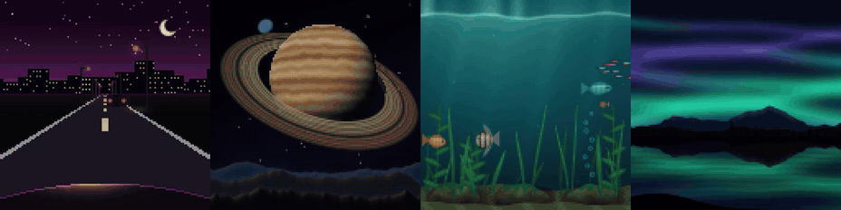

[](https://github.com/sshcrack/led-matrix/releases/latest)
[](https://github.com/sshcrack/led-matrix/actions/workflows/ci.yml)
[](LICENSE)
[](https://en.cppreference.com/w/cpp/23)
[](#hardware)
[](https://github.com/sshcrack/led-matrix/stargazers)

[Quick start](#quick-start) ·
[What is this?](#what-is-this) ·
[Hardware](#hardware) ·
[Install guide](#install-guide) ·
[Desktop app](#desktop-app) ·
[Web UI](#web-ui) ·
[Configuration](#configuration) ·
[Troubleshooting](#troubleshooting) ·
[Development](#development)

</div>

---

## Quick start

> [!IMPORTANT]
> **You need:** a **Raspberry Pi 3 or 4** (the Pi 5 is untested, see [Shopping list](#shopping-list)) running **64-bit** Raspberry Pi OS Lite with a user named **`pi`**, HUB75 LED panels, a HUB75 adapter board or HAT, and a separate **5 V supply** for the panels.

| I have… | Do this |
|:--|:--|
| A Pi with panels wired up | Follow the four steps below (about 10 minutes) |
| A Pi with panels, and I'd rather have an AI agent do it | [**Set up with an AI agent**](#set-up-with-an-ai-agent) |
| Nothing yet (no Pi, panels or adapter) | [**Hardware**](#hardware): what to buy, how to wire and flash it |
| Just a computer, no hardware | [**Try the emulator**](#try-it-without-hardware) |

### 1. Prepare the Pi (one-time)

SSH into the Pi. Its onboard sound shares hardware with the LED driver, so turn it off, as the upstream library recommends:

```bash
echo "blacklist snd_bcm2835" | sudo tee /etc/modprobe.d/blacklist-rgb-matrix.conf
sudo sed -i 's/^dtparam=audio=on/dtparam=audio=off/' /boot/firmware/config.txt   # /boot/config.txt on older images
sudo reboot
```

### 2. Install

```bash
# Download the installer, read it if you like, then run it
curl -fsSLO https://raw.githubusercontent.com/sshcrack/led-matrix/master/scripts/install_led_matrix.sh
bash install_led_matrix.sh
```

The installer downloads the latest `.deb` from [Releases](https://github.com/sshcrack/led-matrix/releases/latest), installs it and starts the service. It asks for:

| Question | What to answer |
|:--|:--|
| Rows / columns per panel | Panel size, e.g. `64` and `64` |
| Chained panels | Panels daisy-chained on one cable (this sets the width) |
| Parallel chains | Number of cables from the adapter (this sets the height) |
| GPIO slowdown | `3` for a Pi 3, `2` for a Pi 4 |
| Spotify, API token, auto-updates | Optional. You can skip all of them and set them up later |

Four 64×64 panels in a 2×2 grid are `64` / `64` / `2` / `2`. Other layouts are in [Working out the numbers](#working-out-the-numbers).

### 3. Open the web UI

Open **`http://<pi-ip-address>:8080/`** on any device on your network (the installer prints the address). On a phone, use *Add to Home Screen* to install it like an app.

1. Press the power button (top right) if the matrix is off.
2. In **Control**, leave the toggle on **Auto** to let the Director pick scenes, or pick **Manual** and click a preset.
3. Press **+** to build a preset: choose a one-tap starting point (Night sky, Digital calm, Desk clock) or pick scenes yourself.
4. Open **Scenes** to browse every scene with an animated preview.

Panels dark, flickering or scrambled? Those are almost always one-flag fixes. See [Troubleshooting](#troubleshooting).

### 4. Optional: install the desktop app on your PC

The [desktop app](#desktop-app) adds music reactivity (from your PC's audio output), GPU shader scenes, music videos, and render offload for heavy scenes. It installs for your user only, with no admin rights, and keeps itself on the same version as your matrix.

| OS | Install |
|:--|:--|
| **Windows** | Run `led-matrix-desktop-<version>-win64.exe` from [Releases](https://github.com/sshcrack/led-matrix/releases/latest) |
| **Linux** (x86_64) | `curl -fsSL https://raw.githubusercontent.com/sshcrack/led-matrix/master/scripts/install-desktop.sh \| sh` |

Start it, enter the Pi's address and port `8080`, and click **Connect**.

### Set up with an AI agent

Coding agents (Claude Code, Codex, Cursor, …) can do the whole setup for you, including the interview about your panels. Run the agent on the computer where you want the [desktop app](#desktop-app) (Windows or Linux) and make sure you can `ssh` into the Pi from it. The agent sets up the Pi over SSH, then installs the desktop app on that computer and connects it to the Pi. Paste:

```text
Set up my LED matrix. Read and follow
https://raw.githubusercontent.com/sshcrack/led-matrix/master/docs/AGENT_SETUP.md
Interview me first, then install and verify everything yourself.
```

The [agent setup guide](docs/AGENT_SETUP.md) is written for machines. It has an interview script that maps your answers to the right flags, a non-interactive install, verification checks, a flicker and colour troubleshooting tree, and rules for handling secrets safely.

### Try it without hardware

The emulator runs the same code as the Pi and shows the matrix in a browser tab, so you can try everything before buying anything. It is built from source (Linux x86_64, see the [build prerequisites](#build-prerequisites)):

```bash
git clone --recurse-submodules https://github.com/sshcrack/led-matrix.git
cd led-matrix
cmake --preset emulator
cmake --build --preset emulator --target install
./scripts/run_web_emulator.sh              # then open http://localhost:8080/web/
```

---

## What is this?

A passive piece of light art for your wall or desk. It runs a growing collection of scenes, picks what to show on its own, and reacts to the music you play. The display shows no tickers and takes no input from viewers. You set it up once and then mostly forget about it.

- **Automatic Mode.** A Director chooses from curated scene looks and composes 24–36 minute visual arcs. While music plays it favours music-reactive scenes. Switch to **Manual** to play your own presets.
- **Follows the real world.** Outdoor scenes match the time of day, weather, season and holidays where the matrix is.
- **Web UI** that works on phones and desktops, installable as a PWA. It has a live 128×128 preview, a scene gallery, a Scene Lab, schedules and diagnostics. See the [tour](#web-ui).
- **Desktop app** (Windows and Linux) for the heavy lifting: GPU shaders, system-audio capture, YouTube music videos. Your PC does the rendering and the Pi just displays pixels. See [Desktop app](#desktop-app).
- **Runs on modest hardware.** Scene quality adapts to the Pi's measured load, and heavy scenes can move to your PC automatically.
- **One `.deb` to install.** A systemd service, safe self-updates with automatic rollback, and a REST API for everything.

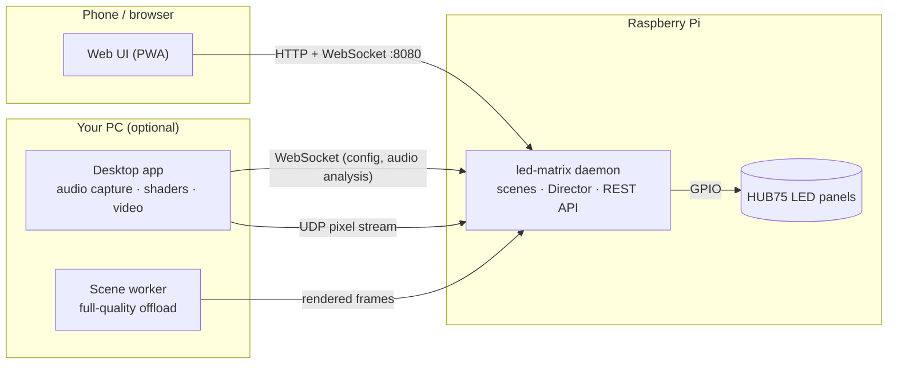

---

## Showcase

<div align="center">

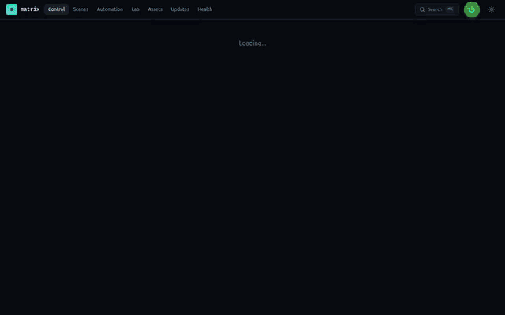

<sub>The web UI: Control → Scenes → Lab → Automation → Health, plus the ⌘K palette.</sub>

</div>

<details>
<summary><b>More scene previews</b> (about 10 MB of animated GIFs)</summary>

<br>

Previews are hosted on the rolling [`scene-previews` release](https://github.com/sshcrack/led-matrix/releases/tag/scene-previews) to keep the git history small. The web UI shows all of them.

<div align="center">

<table>
<tr><td align="center"><br><sub><b>Aurora</b> · shader</sub></td><td align="center"><br><sub><b>Tidal Aquarium</b> · shader</sub></td><td align="center"><br><sub><b>Planetary Vista</b> · shader</sub></td><td align="center"><br><sub><b>Volcano</b> · music-reactive</sub></td></tr>
<tr><td align="center"><br><sub><b>Night Drive</b> · music-reactive</sub></td><td align="center"><br><sub><b>Campfire</b> · music-reactive</sub></td><td align="center"><br><sub><b>Lighthouse</b> · music-reactive</sub></td><td align="center"><br><sub><b>Celestial Bloom</b> · music shader</sub></td></tr>
<tr><td align="center"><br><sub><b>Neon Tunnel</b></sub></td><td align="center"><br><sub><b>Reaction Diffusion</b></sub></td><td align="center"><br><sub><b>Metablob</b></sub></td><td align="center"><br><sub><b>Pac-Man</b> · plays itself</sub></td></tr>
</table>

</div>

</details>

---

## Hardware

An unfinished [printed enclosure CAD project](hardware/oak-panel/README.md) includes portable sources and prototype downloads for a four-panel display. It is not ready for full fabrication.

> [!NOTE]
> This project builds on the excellent [rpi-rgb-led-matrix](https://github.com/hzeller/rpi-rgb-led-matrix) library by Henner Zeller. For wiring diagrams, timing issues and panel quirks, its documentation is the reference.

### Shopping list

| Part | Recommendation |
|:--|:--|
| **Computer** | **Raspberry Pi 4** (best), or Pi 3 B/B+ (works, and the maintainer's 128×128 runs on a Pi 3 B with adaptive quality and desktop offload). A 64-bit OS is required. The Pi 5 is supported by the LED library since [v0.1.13](https://github.com/sshcrack/rpi-rgb-led-matrix/releases/tag/v0.1.13) (RP1 backend, `--led-rp1-pio`), but this app has not been tested on one. |
| **Panels** | HUB75 RGB panels. **Four 64×64 panels in a 2×2 grid make a 128×128 display**, which is the primary target. 32×32 and 64×32 panels work too, and scenes read the canvas size. |
| **Adapter** | A HAT or bonnet that level-shifts GPIO to HUB75, e.g. the [Electrodragon Active-3](https://www.electrodragon.com/product/rgb-matrix-panel-drive-board-raspberry-pi/). [Alternatives](https://github.com/hzeller/rpi-rgb-led-matrix/blob/master/adapter/README.md). |
| **Power** | A dedicated **5 V** supply for the panels, sized generously. Panels can draw several amps each at full white. Power the Pi separately and share ground. Don't power panels from the Pi. |
| **Cables** | The HUB75 ribbon cables that come with the panels, plus power leads for each panel. |
| **Storage** | A microSD card, 16 GB or more. |

### Working out the numbers

The matrix size is **width = `cols` × `chain`** and **height = `rows` × `parallel`**.

| Layout | rows | cols | chain | parallel | Result |
|:--|:-:|:-:|:-:|:-:|:--|
| Four 64×64 panels, 2×2 *(recommended)* | 64 | 64 | 2 | 2 | 128×128 |
| One 64×64 panel | 64 | 64 | 1 | 1 | 64×64 |
| Two 64×32 panels side by side | 32 | 64 | 2 | 1 | 128×32 |
| Four 32×32 panels in a row | 32 | 32 | 4 | 1 | 128×32 |

The installer asks for these. They end up as `--led-rows`, `--led-cols`, `--led-chain` and `--led-parallel` in `/etc/default/led-matrix`. How many parallel chains your adapter supports depends on the adapter, so check its documentation. The Active-3 has three parallel outputs.

### Assemble and wire

1. Plug the **adapter or HAT** onto the Pi's 40-pin header (Pi switched off and unplugged).
2. Connect the adapter's HUB75 output to the **input** of the first panel with the ribbon cable. Panels have an *in* and an *out* side, usually marked with an arrow.
3. For more panels on the same chain, run a ribbon from the first panel's **output** to the next panel's **input**. Use a second adapter output for a second (parallel) chain. Which output is which depends on the adapter, so check its documentation, or the upstream [wiring guide](https://github.com/hzeller/rpi-rgb-led-matrix/blob/master/wiring.md).
4. Connect the **5 V supply** to every panel's power connector (use the supplied power leads). Power the Pi from its own supply. Power everything off before changing any cable.

### Flash the Pi

1. On your computer, install [Raspberry Pi Imager](https://www.raspberrypi.com/software/).
2. Choose your Pi model, then **Raspberry Pi OS Lite (64-bit)** (under *Raspberry Pi OS (other)*), and your SD card.
3. In the customisation settings, set:
   - **Username `pi`** (the installer requires this user) and a password
   - Your **Wi-Fi** name and password (skip if you use Ethernet)
   - **Enable SSH**
   - Optionally a hostname such as `ledmatrix`
4. Write the card, put it in the Pi, and power it on. Give the first boot a couple of minutes.
5. Connect with `ssh pi@ledmatrix.local` (or `ssh pi@<ip-from-your-router>`) and continue with the [Quick start](#1-prepare-the-pi-one-time).

> [!TIP]
> Prefer not to do this alone? Your [AI agent](#set-up-with-an-ai-agent) can walk you through every step above and run the commands over SSH.

---

## Install guide

The [Quick start](#quick-start) covers a normal install. This section is the reference for what gets installed and how to change, update or remove it.

### Requirements

- Raspberry Pi 3 or 4 (Pi 5 untested) with a **64-bit** Debian-based OS (Debian 12 "Bookworm" or newer), a user named **`pi`**, and internet access
- Panels wired and powered (see [Hardware](#hardware))
- The Pi's onboard sound disabled ([step 1 of the Quick start](#1-prepare-the-pi-one-time))

### Install

Use the [installer script](#2-install), or install the package yourself:

```bash
# Download led-matrix-<version>_arm64.deb from the latest release, then:
sudo apt install ./led-matrix-*_arm64.deb
```

Either way, the package:

- installs the daemon to `/usr/bin/led-matrix`, with plugins, web UI and previews under `/usr/lib/led-matrix` and `/usr/share/led-matrix`
- writes your answers to `/etc/default/led-matrix`
- creates `/var/lib/led-matrix/` (config, uploads, crash reports), owned by `pi`
- enables and starts `led-matrix.service` and the updater units

The service starts as root (needed for GPIO) and drops privileges to `pi:pi` as soon as the matrix is initialised.

### Check that it works

```bash
systemctl status led-matrix          # should be active (running)
curl -s localhost:8080/status        # {"turned_on":true, ...}
journalctl -u led-matrix -f          # live logs
```

### Change settings later

> [!IMPORTANT]
> `/etc/default/led-matrix` is **regenerated from the stored answers on every upgrade and reconfigure**, so manual edits to it are lost. Change settings through debconf.

```bash
sudo dpkg-reconfigure led-matrix     # re-asks every question
```

Or non-interactively:

```bash
echo "led-matrix led-matrix/led-slowdown-gpio string 2" | sudo debconf-set-selections
echo "led-matrix led-matrix/extra-opts string --led-brightness=60" | sudo debconf-set-selections
sudo DEBIAN_FRONTEND=noninteractive dpkg-reconfigure led-matrix
```

Any extra [rpi-rgb-led-matrix flag](https://github.com/hzeller/rpi-rgb-led-matrix?tab=readme-ov-file#types-of-displays) goes in `extra-opts`.

### Update and uninstall

Updates run automatically if you enabled them. You can also use the **Updates** page or `POST /api/update/install`, which installs transactionally with rollback. Manually: install a newer `.deb` with `sudo apt install ./led-matrix-*.deb`.

```bash
sudo apt remove led-matrix           # keep your data
sudo apt purge led-matrix            # also removes /var/lib/led-matrix and the stored answers
```

---

## Desktop app

The Pi is deliberately modest. The **desktop app** gives it superpowers by running on a PC on the same network:

| It adds… | How it works |
|:--|:--|
| **Music reactivity** | Captures your system's audio output (WASAPI loopback on Windows, PipeWire/PulseAudio monitor on Linux), analyses it (spectrum, beats, drops, BPM, sections) and streams the result to the Pi. No microphone needed. |
| **GPU shaders** | Renders the `shader:*` scenes (Aurora, Aquarium, Planetary Vista…) and streams pixels to the Pi over UDP. Custom `.frag` files can be uploaded in the web UI under **Assets**. |
| **Video and music videos** | `video` plays YouTube and URL videos, and `spotifymv` auto-plays the music video for your current Spotify track. Needs [`yt-dlp`](https://github.com/yt-dlp/yt-dlp) and ffmpeg on the PC. |
| **Render offload** | A background scene worker runs the same scene code at full quality when the Pi is under pressure. The handoff is seamless, with local fallback if the worker disappears. |

<table>
<tr>
<td width="50%">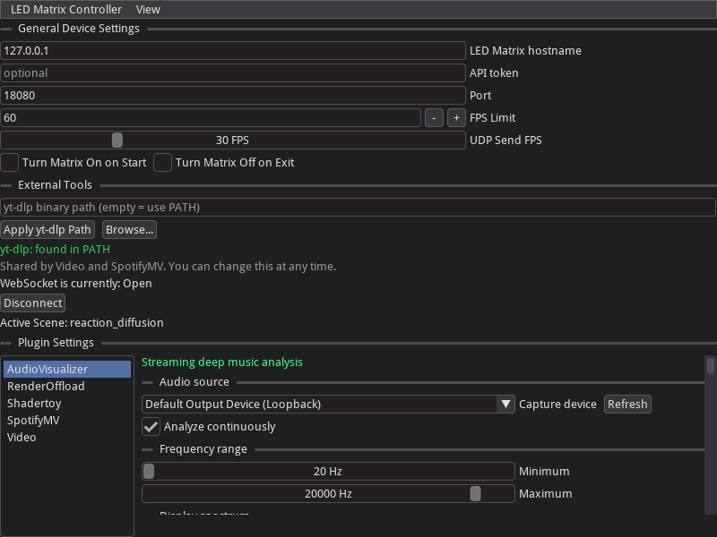<br><sub>Connected, with audio analysis streaming.</sub></td>
<td width="50%">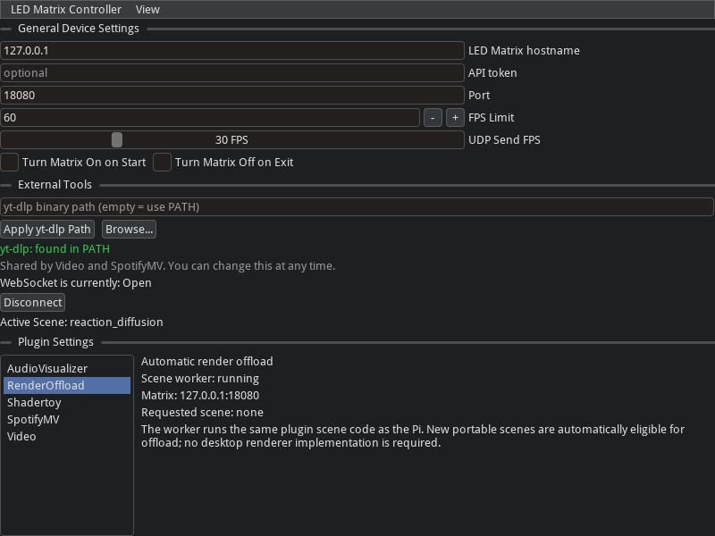<br><sub>The scene worker is running and ready to take over heavy scenes.</sub></td>
</tr>
</table>

### Install

Grab the latest build from [Releases](https://github.com/sshcrack/led-matrix/releases/latest):

| OS | Install (for your user, no admin/root) |
|:--|:--|
| **Windows** | Run `led-matrix-desktop-<version>-win64.exe`, or `irm https://raw.githubusercontent.com/sshcrack/led-matrix/master/scripts/install-desktop.ps1 \| iex` |
| **Linux** (x86_64) | `curl -fsSL https://raw.githubusercontent.com/sshcrack/led-matrix/master/scripts/install-desktop.sh \| sh` (add `-s -- <version>` after `sh` for a specific version). Or download `led-matrix-desktop-<version>-Linux.tar.gz`, extract it and run `bin/led-matrix-desktop --install` |

On Linux the installer adds a launcher entry and `~/.local/bin/led-matrix-desktop`; put `~/.local/bin` on your `PATH` to start it from a terminal.

The app installs to `%LOCALAPPDATA%\led-matrix-desktop` or `~/.local/share/led-matrix-desktop` and **updates itself**: it runs the same release as your matrix (offload requires compatible protocol and scene contracts). When a newer release is out and the matrix has auto-update on, it asks the matrix to update first and follows it. Updates download in the background and apply when the app is hidden in the tray or restarted. You can turn this off in the app menu. An older `.deb` or admin install is replaced on its first update, and the app offers to remove it. Uninstall with `led-matrix-desktop --uninstall` or from Windows *Installed apps*.

### Use

1. Start the app, enter the Pi's **hostname or IP** and the **port** (`8080`), and add the **API token** if you set one.
2. Click **Connect**. The status switches to *WebSocket is currently: Open* and the plugin tabs show what is active.
3. Leave it running in the tray. Enable *Turn Matrix On on Start* if you like.

The app needs to be connected for shader scenes, desktop audio, videos and render offload. Everything else keeps working without it.

---

## Web UI

Open `http://<pi-ip>:8080/` in any browser. On a phone, use *Add to Home Screen* to install it like an app.

<table>
<tr>
<td width="50%"><a href="docs/media/web-control.png">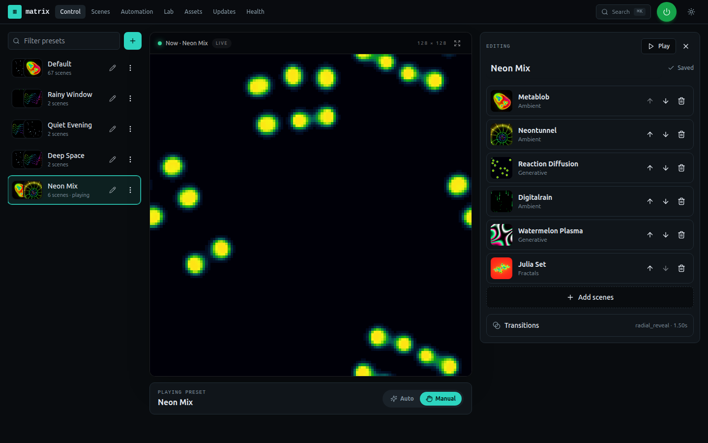</a><br><b>Control.</b> Presets, the live preview, and a one-click Auto/Manual switch. The inspector edits the selected preset in place and autosaves.</td>
<td width="50%"><a href="docs/media/web-scenes.png">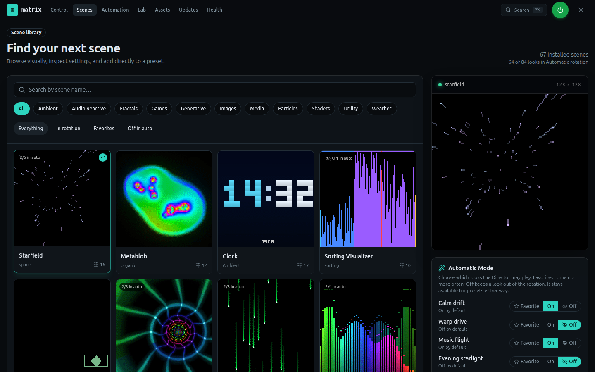</a><br><b>Scenes.</b> Browse every scene with animated previews. Tune what the Director may play: favourite a look, keep it, or switch it off.</td>
</tr>
<tr>
<td><a href="docs/media/web-lab.png">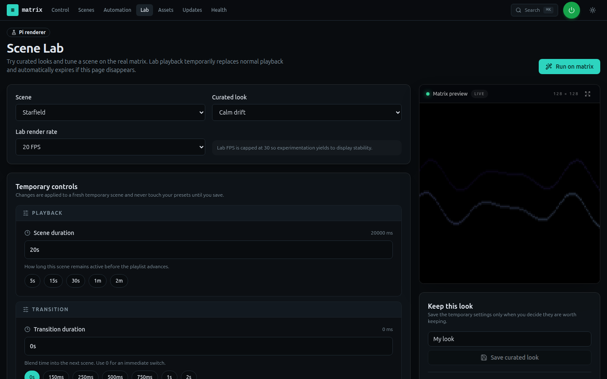</a><br><b>Lab.</b> Try scenes on the real Pi renderer with temporary controls. Nothing is saved until you decide.</td>
<td><a href="docs/media/web-automation.png">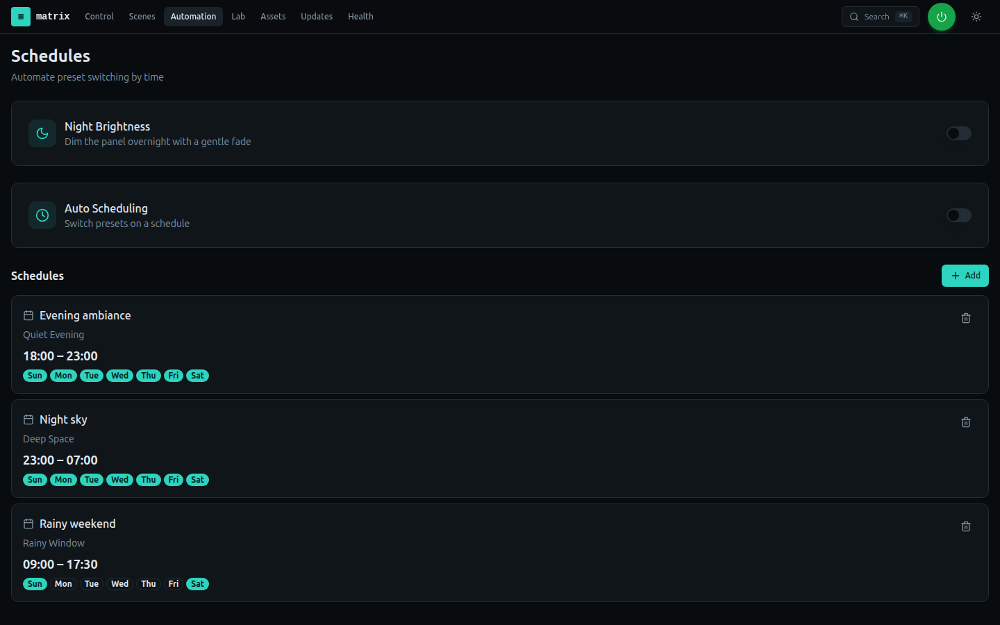</a><br><b>Automation.</b> Time-of-day schedules and a night-brightness fade.</td>
</tr>
<tr>
<td><a href="docs/media/web-health.png">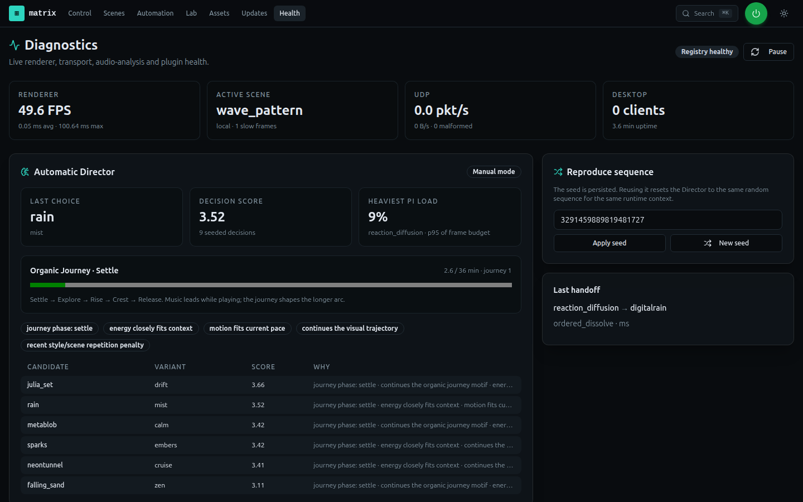</a><br><b>Health.</b> Renderer FPS, transport stats, and a transparent view of why the Director chose what it chose.</td>
<td><a href="docs/media/web-builder.png">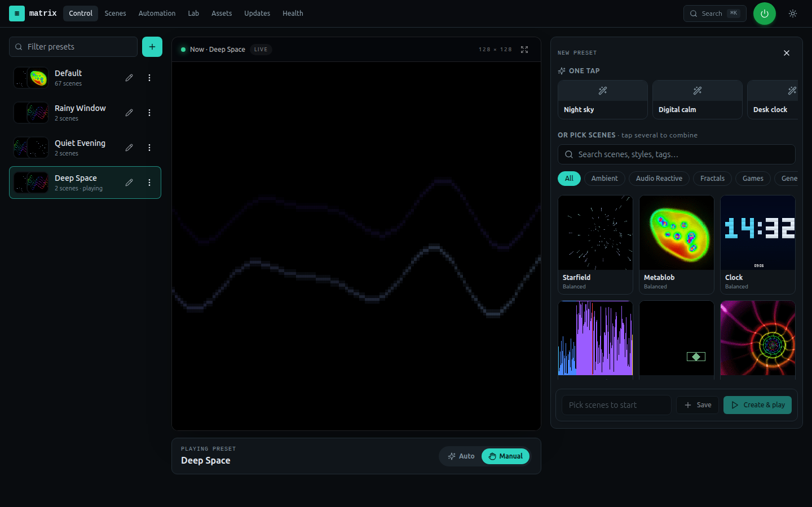</a><br><b>Quick builder.</b> Create <i>and play</i> a preset in one step from one-tap starting points or any scenes you pick.</td>
</tr>
</table>

Press <kbd>Ctrl</kbd>/<kbd>⌘</kbd>+<kbd>K</kbd> anywhere for the command palette, and use the sun/moon button for the light theme.

<details>
<summary><b>On your phone, and in light mode</b></summary>

<br>

<div align="center">
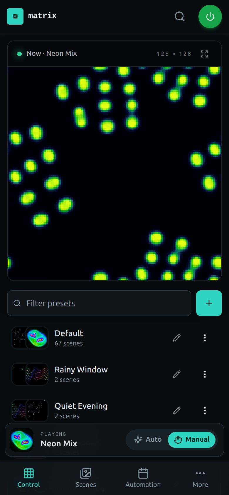
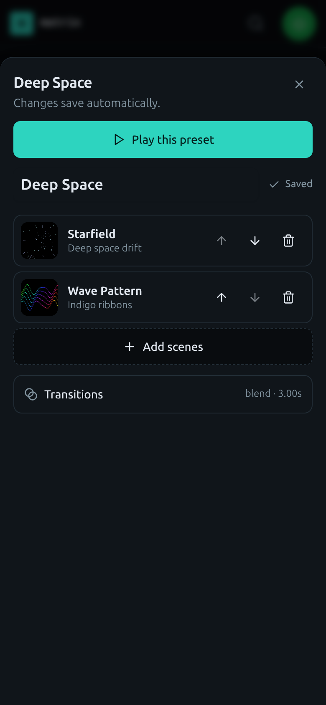
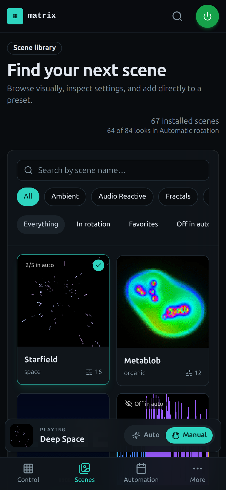
<br><br>
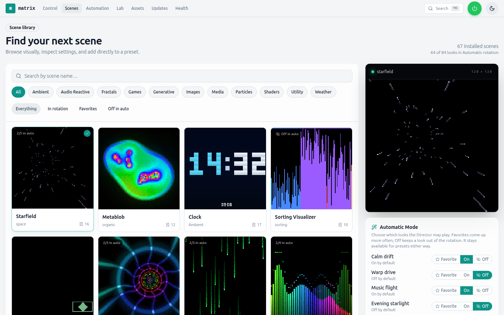
</div>

On screens narrower than 1024 px the layout switches to a bottom tab bar with an always-visible mini-player, and editors open as bottom sheets.

</details>

---

## Features

### Scenes

Scenes are supplied by plugins. Native scenes render on the Pi or desktop worker; shader and video scenes need the desktop app. Browse **Scenes** in the web UI for the installed catalog.

| Category | Highlights |
|:--|:--|
| **Audio reactive** | A spectrum analyser, particles, and small scenic worlds that dance to the music: campfire, volcano, lighthouse, reef, skate park, tesla coil, night drive, roller rink… plus `music_director`, an automatic DJ |
| **Shaders** | GPU scenes rendered on your PC: Aurora, Tidal Aquarium, Planetary Vista, Plasma Garden, and music shaders (Celestial Bloom, Subwoofer, Tube Amp…). Add your own `.frag` files |
| **Hobbies & activities** | Hiking trails and an alpine lake, horses in the mist, basketball and football, and cycling a coast road or skiing a slope |
| **Ambient** | A forest path and a cottage that change with the seasons, a Christmas market and a sleigh over a snowy village (December only in Automatic Mode), plus Starfield, Metablob, Clock, Digital Rain, Neon Tunnel, Sorting Visualizer, Bouncing Logo |
| **Games** | Self-playing Tetris, Pac-Man, Snake, Pong, Maze |
| **Generative** | Reaction-diffusion, Boids, Falling Sand, Watermelon Plasma, Wave |
| **Fractals** | Julia set, Game of Life, Wave Pattern |
| **Particles** | Rain, Sparks |
| **Media** | YouTube music videos that follow your Spotify track, a video player, and Spotify cover art when connected |
| **Weather** | Live weather and a weather landscape that shows the real sky outside (via Open-Meteo, no API key) |
| **Utility / Images** | Countdown with fireworks, and a pixel-art and image provider |

Plus **7 post-processing effects** (flash, rotate, glow, RGB split, glitch, pixelate, shockwave; they can fire on beats) and **11 transitions** (blend, swipe, morph, radial reveal, dissolves, CRT collapse, …).

### Control

| Feature | What it does |
|:--|:--|
| **Automatic Mode** | The Director picks from curated looks, plans long arcs, and uses music state when it is available. Every look can be starred or excluded in the Scenes page. Pick a style on the home screen: **Mixed** (everything, music first), **Outside** (calm scenery that matches the real time, weather, season and holidays), **Party** (energetic music looks, quicker cuts) or **Chill** (slow and soft, long dwell). Holiday scenes such as the Christmas market only play while their holiday is on. |
| **Presets** | Ordered lists of scenes with per-scene properties and transitions. Edits autosave, and deleting a preset can be undone. Three one-tap ambiance packs are included. |
| **Scene Lab** | Try a scene or curated look on the real Pi renderer with temporary controls, then save it only if you like it. |
| **Schedules** | Switch presets by time and weekday (overnight ranges work) and dim the panel at night with a smooth brightness fade. While *Auto Scheduling* is on, an active schedule takes over from Automatic Mode, and the display turns **off** outside every schedule window. Add windows for all the hours you want lit, or leave it off. |
| **Real-world scenery** | Outdoor scenes follow the real time of day, weather and season where the matrix is: sunset light, rain, fog, snow on the ground, autumn leaves, decorations at Christmas. The location is detected from the IP address or set by city. You can override it for every scene (snow all winter, always night) or pin a single scene, or turn it off. See [Real-world scenery](#real-world-scenery-optional). |
| **Live preview** | A real-time view of the composed matrix frame, pulled on demand so an idle page costs the Pi nothing. |
| **Plugin UIs** | Plugins can ship their own web controls, for example the YouTube playlist editor. |
| **Safe updates** | Check and install updates from the UI. The updater health-checks the new version and rolls back automatically on failure ([details](docs/transactional-updates.md)). The desktop app updates itself to the same release. |
| **Diagnostics** | Per-scene frame-time percentiles, Director reasoning, desktop-offload status and audio analysis in the **Health** page. |

### Under the hood

- **Adaptive quality.** Scenes scale optional detail to the Pi's measured load (`render_quality_scale()`). See [scene execution](docs/SCENE_EXECUTION.md).
- **Automatic desktop offload.** If a scene is too heavy, the Pi hands it to the desktop scene worker at full quality and falls back locally if the PC disappears.
- **Plugins are one folder.** Drop in `plugins/MyPlugin/`, call `register_plugin()`, and you have a scene. See [plugin development](docs/PLUGIN_DEVELOPMENT.md).
- **Memory-safety tooling.** Builds enable standard-library assertions, and sanitizer presets help catch memory and threading bugs. See the [memory safety report](docs/memory-safety-report.md).

---

## Configuration

### Common matrix flags

Passed to the daemon via `MATRIX_OPTS` (set them through debconf, see above). The full list is in the [upstream docs](https://github.com/hzeller/rpi-rgb-led-matrix).

| Flag | Use it when… |
|:--|:--|
| `--led-slowdown-gpio=N` | The picture flickers or has noise. Higher is slower and cleaner (`3` for Pi 3, `2` for Pi 4; try `4` if needed). |
| `--led-brightness=N` | You want less brightness, heat or power draw (1–100). |
| `--led-rgb-sequence=RBG` | Colours are swapped. Try `RBG`, `BGR`, `GRB`, … |
| `--led-gpio-mapping=adafruit-hat` | You use an Adafruit HAT or Bonnet rather than a plain adapter. |
| `--led-multiplexing=N` / `--led-row-addr-type=N` | The image looks scrambled, striped or only half-lit. Try values `0`–`24` / `0`–`5`. |
| `--led-rp1-pio=1` | Pi 5 only (untested with this app): use the low-CPU RP1 PIO backend instead of the default RIO one. |
| `--led-panel-type=FM6126A` | Panels stay dark or show garbage at init. Common with newer 64×64 panels (also `FM6127`). |
| `--led-pixel-mapper="Rotate:90"` | You mounted the display rotated, or need the `U-mapper` for snake-wired panels. |
| `--led-pwm-bits=N`, `--led-limit-refresh=N` | You want to trade colour depth for refresh rate (e.g. to stop flicker on camera). |

### Environment variables

Set persistent variables with a systemd override. Use `sudo systemctl edit led-matrix` and add `Environment=` lines. These survive upgrades, unlike `/etc/default/led-matrix`.

| Variable | Purpose |
|:--|:--|
| `PORT` | HTTP and UDP port (default `8080`). |
| `SPOTIFY_CLIENT_ID` | Optional Spotify Client ID default. A Client ID saved in the web UI takes precedence. (`SPOTIFY_CLIENT_SECRET` is only used to keep older secret-based logins refreshing; new sign-ins use PKCE and need no secret.) |
| `LED_MATRIX_API_TOKEN` | Require a token for the API and web UI (see [Security](#security)). |
| `LED_MATRIX_ALLOWED_ORIGINS` | Comma-separated extra browser origins, e.g. a dev server. |
| `SHADERTOY_API_KEY` | Optional: use the official Shadertoy API for the random `shadertoy` scene. |
| `SPDLOG_LEVEL` | `trace`, `debug`, `info`, `warn`, `error`, `critical`, `off`. |

### Spotify (optional)

Enables the album-cover scene, track-change reactions, genre-aware scene choice and the music-video scene.

Open the matrix web UI on your phone or computer. The **Connect Spotify** guide opens automatically when Spotify is not configured. Choose **Dismiss setup** to hide it for this browser; reopen it any time from **Integrations** (on phones: **More → Integrations**).

1. Follow **Create a Spotify app** to open the developer dashboard. Add the exact redirect URI shown in the guide: **`https://spotify-auth.sshcrack.me/callback`**.
2. Paste the app’s Client ID into the guide and choose **Save Client ID**. No Client secret is needed.
3. Choose **Connect Spotify** and approve access in the new tab.
4. After you approve Spotify, a small hosted page sends your browser straight back to your matrix, from any phone or computer on your network. If that does not happen, copy the page's **full address**, expand **Not sent back to your matrix?** in the guide, paste it, and choose **Finish connecting**.
5. Play music in Spotify. Expand the Spotify row’s **Settings** to reconnect or change credentials later.

No SSH tunnel or daemon restart is needed. On the same computer with the daemon on port 8080, the callback completes automatically. Spotify requires HTTPS redirect URIs except for explicit loopback addresses; `localhost` and your Pi’s HTTP address cannot replace the supplied URI. Development-mode apps require the app owner to have Premium, and other accounts must be added under User Management. See the [full setup and troubleshooting guide](plugins/SpotifyScenes/README.md).

A [getsongbpm.com](https://getsongbpm.com/api) key is optional. Set it as `song_bpm_api_key` under `pluginConfigs` in `/var/lib/led-matrix/config.json`.

### Real-world scenery (optional)

Outdoor scenes (hiking, horses, sports, the seasonal landscapes, the campfire, the weather landscape) follow the real time of day, weather and season. It is on by default and needs no key: the location comes from the Pi's IP address (ipwho.is, then ipapi.co) and the weather from Open-Meteo every 15 minutes. Sun, moon and season are computed on the Pi.

Open **Integrations → Real-world scenery** in the web UI to:

- turn it off (scenes then show their designed look),
- set the location by searching a city, or turn off IP detection,
- override every scene: a time of day, a weather (rain, snow, fog, …), a season, or holiday decorations (by the calendar, none, or always the ones you pick).

Each adapting scene also has **Time of day**, **Weather** and **Season** properties in its *Environment* group. *Auto* follows the settings above; any other value pins that scene. Fixed looks (`night`, `rain`, `winter`, …) are also available as variants in Scene Lab and presets. Every aspect resolves on its own, in this order: scene property, then the global override, then the real world, then the scene's design.

Automatic Mode uses the same moment: it leans towards scenes that fit it (a rainy-window scene when it rains, night drives after dark), strongly in the **Outside** style and gently in **Mixed**. Holiday scenes (the Christmas market and sleigh) only play in Automatic Mode while their holiday is on, by the calendar or forced here.

The live Weather scene still uses the latitude and longitude in its own properties.

### Security

The API is open to your local network by default. Browser requests from *other websites* are rejected, but any device on your network can use it. The Spotify OAuth callback is the exception: it validates a one-time, expiring login state instead of the API token.

- **Set an API token** in the installer (or `sudo dpkg-reconfigure led-matrix`). The web UI asks for it once and the desktop app has a matching field. API clients send `Authorization: Bearer <token>` or `X-Api-Token`.
- Don't expose port 8080 to the internet. Use a VPN or SSH tunnel for remote access.

### Files and paths

| What | Where |
|:--|:--|
| Service and logs | `led-matrix.service`, `journalctl -u led-matrix` |
| Flags and secrets | `/etc/default/led-matrix` (root only, managed by debconf) |
| Presets, schedules, settings | `/var/lib/led-matrix/config.json` |
| Uploaded shaders and images | `/var/lib/led-matrix/data/` |
| Crash reports | `/var/lib/led-matrix/crashes/` |
| Update log | `/var/log/led-matrix-update.log` |

Back up `/var/lib/led-matrix/config.json` to keep your presets.

---

## Troubleshooting

| Symptom | Try this |
|:--|:--|
| **Nothing lights up** | `systemctl status led-matrix` and `journalctl -u led-matrix -n 50`. Check the panel power and the ribbon cable direction (*in* vs *out*). Try `--led-panel-type=FM6126A`. |
| **Flicker or noise** | Raise `--led-slowdown-gpio` (2 → 3 → 4), disable the Pi's onboard sound ([Quick start step 1](#1-prepare-the-pi-one-time)) and check the power supply. |
| **Wrong colours** | Set `--led-rgb-sequence` (`RBG`, `BGR`, …). |
| **Scrambled, striped or half-lit image** | Try other `--led-multiplexing` values (0–24) and `--led-row-addr-type` (0–5). |
| **Image is mirrored, rotated or in the wrong order** | Use `--led-pixel-mapper`, or re-check that `chain` and `parallel` match your wiring. |
| **Web UI won't load** | Confirm the IP, port 8080 and `curl localhost:8080/status` on the Pi. If you set an API token, the UI asks for it once. |
| **Scene is slow or choppy** | Open **Health**. Heavy scenes shift to the desktop scene worker when it is connected, and quality adapts otherwise. Connect the [desktop app](#desktop-app). |
| **Heavy scenes don't move to the desktop** | Check protocol and scene-contract compatibility in **Health**. With *Match Matrix Version* on (the default), the app switches to the Pi's version within minutes; the update status is shown in the app's *LED Matrix Controller* menu. **Health** → `render_placement.reason` says why a scene stayed on the Pi. |
| **Shader, video or music scenes are black or missing** | They need the [desktop app](#desktop-app) connected. Check the *WebSocket is currently: Open* line. |
| **No audio reactivity** | The desktop app captures *system output*, so play something on that PC. Check the capture device in the AudioVisualizer tab. |
| **My settings reverted after an upgrade** | You edited `/etc/default/led-matrix` by hand. Use `debconf-set-selections` and `dpkg-reconfigure` ([Change settings later](#change-settings-later)). |
| **Update failed** | Read `/var/log/led-matrix-update.log`. The updater rolls back by itself and reports on the Updates page. |
| **The service crashed** | Crash reports are in `/var/lib/led-matrix/crashes/`. Please attach one to an issue. |

Still stuck? [Open an issue](https://github.com/sshcrack/led-matrix/issues) with your Pi model, panel type, the flags in `/etc/default/led-matrix` (minus secrets) and `journalctl -u led-matrix -n 100`.

---

## REST API

Everything the web UI does goes through a REST API on port 8080. Examples assume no token. If you set one, add `-H "Authorization: Bearer $TOKEN"`.

```bash
curl localhost:8080/status                           # power, mode, active preset
curl localhost:8080/list_presets                     # all presets
curl "localhost:8080/set_active?id=<preset-id>"      # play a preset
curl "localhost:8080/operation_mode?mode=automatic"  # or: manual
curl "localhost:8080/set_enabled?enabled=false"      # turn the display off
curl localhost:8080/skip                             # next scene
curl -X POST "localhost:8080/post_processing/flash?duration=0.3&intensity=1.0"
```

<details>
<summary><b>Endpoint reference</b></summary>

<br>

| Area | Method | Endpoint | Description |
|:--|:--|:--|:--|
| **State** | GET | `/status` | Power, operation mode, active preset |
| | GET | `/get_curr` | Scenes of the active preset with their properties |
| | GET | `/toggle`, `/set_enabled?enabled=<bool>` | Toggle or set display power |
| | GET | `/operation_mode?mode=automatic\|manual` | Switch between the Director and presets |
| | GET | `/skip` | Skip to the next scene |
| **Presets** | GET | `/list_presets`, `/presets[?id=]` | List presets / fetch one |
| | GET | `/set_active?id=` | Play a preset |
| | POST | `/add_preset[?id=]` | Create a preset (JSON body) |
| | POST | `/preset?id=` | Replace a preset |
| | POST | `/preset_display_name?id=` | Rename a preset |
| | DELETE | `/preset?id=` | Delete a preset |
| | GET / POST | `/ambiance_packs`, `/ambiance_packs?id=` | List packs / create a preset from a pack |
| **Scenes** | GET | `/list_scenes` | All scenes with properties, capabilities and descriptors |
| | GET | `/list_transitions` | Available transitions |
| | GET | `/scene_preview?name=` | Preview GIF of a scene |
| | GET | `/list`, `/image?url=`, `/list_providers`, `/list_shader_providers` | Images and providers |
| **Scene Lab** | GET | `/scene_lab` | Lab state |
| | POST | `/scene_lab/start`, `/update`, `/heartbeat`, `/stop` | Run a temporary scene (expires without heartbeats) |
| | POST | `/scene_lab/save_preset`, `/save_variant` | Keep what you tuned |
| **Automation** | GET / POST / DELETE | `/schedule[?id=]`, `/schedules` | Manage time schedules |
| | GET / POST | `/scheduling_status` | Read or set whether schedules are active |
| | GET / POST | `/brightness_schedule` | Night brightness fade |
| | GET / POST | `/automatic_director/preferences` | Favourite and excluded looks |
| | POST | `/automatic_director/seed` | Set a reproducible random seed |
| | GET / POST | `/automatic_director/mode` | Automatic Mode style: `mixed`, `environment`, `party` or `chill` (POST `{"mode": "party"}`) |
| **Effects** | POST | `/post_processing/flash`, `/rotate`, `/clear`, `/effect/<name>` | Trigger or clear effects (`duration`, `intensity`) |
| | GET | `/post_processing/status`, `/config` | Effect registry and beat config |
| **Live and diagnostics** | WS | `/live_frame` | Pull-based live frames (send `next`, receive one binary `LMF1` frame) |
| | GET | `/diagnostics`, `/runtime_inputs` | Health, per-scene timing, audio state, offload status |
| **Updates** | GET | `/api/update/status`, `/api/update/releases` | Update state / recent releases |
| | POST | `/api/update/check`, `/install[?version=]`, `/config` | Check, install, configure auto-update |
| **Assets** | GET / POST / DELETE | `/api/custom-assets/<type>[/<file>]` | Custom shaders |
| **Plugins** | GET | `/plugin_ui`, `/plugin_ui/<Name>/ui.js` | Plugin web UI bundles |
| **Real-world scenery** | GET / POST | `/environment` | Settings, detected location, current conditions and occasions. POST takes a partial patch (`enabled`, `auto_locate`, `latitude`/`longitude`/`label`, `overrides`); `"latitude": null` clears the manual location |
| | GET | `/environment/geocode?q=` | City search for the location setting |
| **Integrations** | GET | `/spotify/status` | Spotify setup and connection status (never returns the secret) |
| | POST | `/spotify/credentials`, `/spotify/connect`, `/spotify/complete` | Save app credentials, start sign-in, finish with a pasted callback address |
| | GET | `/spotify/callback` | Complete a local OAuth redirect using a one-time login state |
| | WS | `/desktopWebsocket` | Desktop app link |

Schedule body:

```json
{ "name": "Evening ambiance", "preset_id": "<id>", "start_hour": 18, "start_minute": 0,
  "end_hour": 23, "end_minute": 0, "days_of_week": [0,1,2,3,4,5,6], "enabled": true }
```

`days_of_week`: `0` = Sunday … `6` = Saturday. Ranges may span midnight.

The UI is the best documentation for payload shapes: open your browser's dev tools, or read `src_matrix/server/`.

</details>

---

## Development

Three programs share one repository:

| Directory | What | Where it runs |
|:--|:--|:--|
| `src_matrix/` | The daemon: scene engine, Director, REST API, GPIO output | Raspberry Pi (and the emulator) |
| `src_desktop/` | ImGui desktop app, audio analysis, shaders, scene worker | Windows / Linux PC |
| `react-web/` | The web UI (Vite, React, TypeScript, Tailwind) | Served by the daemon |
| `plugins/<Name>/` | Scenes and features, with `scenes/`, `matrix/` and optional `desktop/` | Pi, preview generator and desktop worker |
| `shared/` | Shared libraries for common, matrix and desktop code | All of them |

### Build prerequisites

- A C++23 compiler (GCC 12+ or Clang 15+), CMake, Ninja, Git, Python 3 with `jinja2`
- [vcpkg](https://github.com/microsoft/vcpkg): export `VCPKG_ROOT`, or clone it to `vcpkg/` inside or next to the main checkout and the build finds it
- Node 22 and pnpm (the emulator and Pi builds include the web UI unless you pass `-DSKIP_WEB_BUILD=ON`)
- On Debian or Ubuntu:

```bash
sudo apt install build-essential cmake ninja-build git curl pkg-config autoconf automake libtool python3 python3-jinja2 \
  libgraphicsmagick1-dev libasound2-dev libltdl-dev linux-libc-dev libx11-dev libxft-dev libxext-dev libwayland-dev \
  libxkbcommon-dev libegl1-mesa-dev libibus-1.0-dev libxrandr-dev wayland-protocols extra-cmake-modules xorg-dev \
  libxinerama-dev libxcursor-dev libxi-dev libgtk-3-dev libayatana-appindicator3-dev
```

A ready-made [Dev Container](https://vscode.dev/redirect?url=vscode://ms-vscode-remote.remote-containers/cloneInVolume?url=https://github.com/sshcrack/led-matrix) has all of this installed.

### Presets

| Preset | Builds | Output directory |
|:--|:--|:--|
| `emulator` | x64 daemon with an SDL or headless emulator, for local development | `emulator_build/` |
| `cross-compile` | arm64 daemon and `.deb` for the Pi | `build/` |
| `desktop-linux`, `desktop-windows` | Desktop app and scene worker | `desktop_build/` |
| `*-asan`, `*-tsan` | Sanitizer variants | `*_asan_build/`, … |

`ENABLE_EMULATOR` and `ENABLE_DESKTOP` cannot both be on. Use separate presets.

```bash
cmake --preset emulator -DSKIP_WEB_BUILD=ON          # skip the web build when you didn't touch react-web/
cmake --build --preset emulator --target install

./scripts/run_emulator.sh                            # SDL window, 128×128 at 4× scale
./scripts/run_web_emulator.sh                        # headless, view it in a browser (also from your phone)
./scripts/run_web_emulator.sh --scene audio_spectrum # pin a scene while developing

ctest --test-dir emulator_build --output-on-failure  # unit and smoke tests

cd react-web && pnpm install && pnpm dev             # web UI dev server, proxies to localhost:8080
```

`LED_MATRIX_DEV_API=http://<pi>:8080 pnpm dev` points the dev server at a real matrix. For Pi builds use `cmake --preset cross-compile && cmake --build --preset cross-compile --target package`, or `./build_upload.sh` to build, copy and install on a Pi called `ledmat`.

New git worktrees build in seconds thanks to a shared ccache and vcpkg binary cache. Run `scripts/setup_worktree.sh --build`.

### Writing a plugin

```text
plugins/MyPlugin/
├── CMakeLists.txt        # register_plugin(MyPlugin matrix/MyPlugin.cpp scenes/MyScene.cpp ...)
├── scenes/MyScene.{h,cpp}
└── matrix/MyPlugin.{h,cpp}   # extern "C" createMyPlugin / destroyMyPlugin
```

Write a scene once and it runs on the Pi, in previews and on the desktop worker. Plugins can add properties that auto-serialise and appear in the UI, web controls, REST routes, runtime inputs, effects and transitions.

- [Plugin development guide](docs/PLUGIN_DEVELOPMENT.md)
- [Scene execution, previews and offload](docs/SCENE_EXECUTION.md)
- [Shader authoring](plugins/Shadertoy/SHADER_AUTHORING.md)
- Start from `plugins/ExampleScenes/`

Changes to the LED driver itself go into the [rpi-rgb-led-matrix fork](https://github.com/sshcrack/rpi-rgb-led-matrix). Follow the [library release workflow](docs/MATRIX_LIBRARY.md) to ship them there and consume the published release here.

### Previews and media

Scene GIFs are **not** committed to git. They are release assets (`./scripts/fetch_scene_previews.sh`, `./scripts/generate_scene_previews.sh`, `./scripts/publish_scene_previews.sh`). For pull requests, `./scripts/render_scene_video.sh --scenes <a,b>` renders LED-panel-style videos. See [`AGENTS.md`](AGENTS.md) for the repo-size rules.

### Documentation map

| | |
|:--|:--|
| [`AGENTS.md`](AGENTS.md) | Contributor and coding-agent handbook: build caches, sanitizers, web architecture, rules |
| [`CONTEXT.md`](CONTEXT.md) | Domain glossary (Runtime Input, Director, Scene Lab, …) |
| [`docs/AGENT_SETUP.md`](docs/AGENT_SETUP.md) | Agent-driven setup guide for end users |
| [`docs/automatic-journeys.md`](docs/automatic-journeys.md) | How Automatic Mode composes arcs |
| [`docs/transactional-updates.md`](docs/transactional-updates.md) | How updates and rollbacks work |
| [`docs/memory-safety-report.md`](docs/memory-safety-report.md) | Safety tooling, historical findings and verification limits |
| [`docs/README.md`](docs/README.md) | Architecture references and dated performance reports |
| [GitHub issues](https://github.com/sshcrack/led-matrix/issues) · [Led Matrix project](https://github.com/users/sshcrack/projects/7) | Planned work, priorities and progress |

---

## Contributing

Contributions are welcome: scenes, performance work, hardware support, docs, an assembly guide.

1. Fork and branch (`git checkout -b feature/my-scene`).
2. Build with the emulator ([Development](#development)), run `ctest`, and for visual changes attach a short video made with `render_scene_video.sh`.
3. Open a pull request describing what changed and why.

Design rules for new scenes: calm and glanceable, **low compute** (the Pi is modest), **no input from viewers**, **no readable text** (no tickers or scores), and visually interesting on their own. The [`AGENTS.md`](AGENTS.md) *Design constraints* section lists ideas that were already considered and rejected.

## License

GPL-3.0. See [LICENSE](LICENSE).

## Acknowledgments

- [rpi-rgb-led-matrix](https://github.com/hzeller/rpi-rgb-led-matrix) by Henner Zeller, the foundation that makes this possible
- [RGBMatrixAnimations](https://github.com/Footleg/RGBMatrixAnimations) by Footleg, particle animations
- [matryx-gl](https://github.com/Knifa/matryx-gl) by Knifa, community effects
- [Fluent Emoji](https://github.com/microsoft/fluentui-emoji) by Microsoft, the crystal-ball app icon
- Every open-source library in [`vcpkg.json`](vcpkg.json)

<div align="center">

<sub>Made with ❤️ by <a href="https://github.com/sshcrack">sshcrack</a> for the LED matrix community. If it makes your wall prettier, a ⭐ is appreciated.</sub>

</div>
