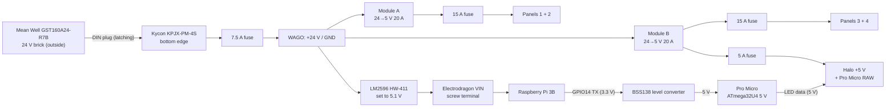

# Wiring: off-the-shelf power and halo

Status (2026-11-15): **plan, not yet built or measured.** This replaces the custom power/halo
board (paused, draft PR #218) with bought modules that are wired by hand. Tracking: #172 (power),
#208 (halo), #171 (enclosure).

Display: 2×2 Waveshare P3 64×64 panels (128×128) on a Raspberry Pi 3B with the Electrodragon
MPC1119 (V2) HUB75 adapter, `--led-chain=2 --led-parallel=2`. The HUB75 ribbons are unchanged and
not shown here.

## Overview



```
brick ─ DIN ─ jack ─ 7.5 A ─┬─ Module A ─ 15 A ─ panels 1+2
                            ├─ Module B ─┬─ 15 A ─ panels 3+4
                            │            └─ 5 A ─ halo strip + Pro Micro RAW
                            └─ LM2596 (5.1 V) ─ Electrodragon VIN ─ Pi
Pi GPIO14 ─ BSS138 converter (3.3→5 V) ─ Pro Micro RXI … Pro Micro pin 6 ─ 330 Ω ─ strip DIN
```

## Loads

| Load | Worst case (all white, full brightness) | Supplied by |
|---|---|---|
| Panels 1 + 2 | 40 W, 8 A | Module A (20 A) |
| Panels 3 + 4 | 40 W, 8 A | Module B (20 A) |
| Halo, owner's WS2812B 5 V strip (30 LEDs/m), ~1.3 m ≈ 40 LEDs | 12 W, 2.4 A full white; firmware caps it lower | Module B |
| Pi 3B + Electrodragon, no USB devices | ~3–6 W, 0.5–1.2 A | LM2596 |
| **24 V input** | ≈ 98 W load, ≈ 110 W input at ~90 % → **≈ 4.6 A** | brick 160 W |

Each module stays under about 55 % of its rating even on a full-white frame.

## Connections

Wire: the owner's 1.5 mm² stranded (450/750 V) for everything that carries power. Thin
(0.14–0.25 mm²) wire for signals. Join wires with WAGO 221 lever connectors (strip 11 mm).

### 24 V input

| From | To | Note |
|---|---|---|
| Jack pins 1 + 4 | +24 V (join both) | GST160A pinout: 1, 4 = +V; 2, 3 = −V |
| Jack pins 2 + 3 | GND (join both) | −V is tied to mains earth in the brick (Class I) |
| +24 V | 7.5 A blade fuse | inline holder, as close to the jack as possible |
| fuse | WAGO **+24 V** (5-way) | outputs: module A IN+, module B IN+, LM2596 IN+ |
| GND | WAGO **GND** (5-way) | outputs: module A IN−, module B IN−, LM2596 IN− |

**Meter-check the jack pigtail before the first connection:** +24 V on the + WAGO, plug in the
brick, measure, then connect the modules.

### Panels

| From | To |
|---|---|
| Module A OUT+ | 15 A fuse → VCC (red) of the panel 1+2 cable |
| Module A OUT− | GND (black) of the panel 1+2 cable |
| Module B OUT+ | WAGO (3-way): 15 A fuse → VCC of the panel 3+4 cable; 5 A fuse → halo +5 V |
| Module B OUT− | WAGO (3–5-way): GND of the panel 3+4 cable, halo GND, Pro Micro GND |

The module leads (13 cm, bare) and the panel cables join in WAGOs or through the inline fuse
holders. Fork crimps are not needed with WAGOs. If you use a barrier strip instead, crimp
**blue** forks (1.5–2.5 mm²) and pull-test each one.

### Pi and Electrodragon

| From | To | Note |
|---|---|---|
| LM2596 OUT+ | Electrodragon **VIN** screw terminal | max 5.5 V. Set **5.1 V** before connecting |
| LM2596 OUT− | Electrodragon **GND** screw terminal | |

- Check that the LM2596's input electrolytic is rated **≥ 35 V** (printed on the can).
- Set the output to 5.1 V with no load, connect, then re-measure with the Pi running. Fix the
  trim pot with a dab of nail polish: drift above 5.5 V kills the Pi.
- Don't power the Pi from USB at the same time.

### Halo

Controller: the owner's **Pro Micro (ATmega32U4, 5 V, 16 MHz)**. It runs at 5 V, so its LED data
needs no level shifter. The Pi's 3.3 V UART goes through the owner's BSS138 level converter
instead (fine at UART speeds).

| From | To | Note |
|---|---|---|
| Electrodragon extra pin **IO14** (silkscreen says "IO12": vendor typo) | level converter **LV1** | Pi UART TX, 3.3 V |
| Electrodragon **3.3V** pin | level converter **LV** | |
| Pro Micro **VCC** | level converter **HV** | 5 V side |
| level converter **HV1** | Pro Micro **RXI** (pin 0, `Serial1`) | Pro Micro TX stays unconnected: nothing ever drives a Pi pin |
| Electrodragon GND, Pro Micro GND | level converter **GND** (both sides) | common reference |
| Halo +5 V (after the 5 A fuse) | Pro Micro **RAW** and strip +5 V | do not plug USB into the Pro Micro while this is connected: unplug the RAW wire to flash |
| Pro Micro **pin 6** | 330 Ω → strip **DIN** | 5 V data |
| — | 1000 µF / ≥ 10 V electrolytic across strip +5 V/GND at the strip input | absorbs switch-on surge |

Firmware note: AVR WS2812 libraries (FastLED, Adafruit NeoPixel) turn interrupts off while
sending, about 1.2 ms for 40 LEDs, and bytes arriving then are lost. The firmware therefore
updates the LEDs only after a complete, checksummed frame and the Pi sends short frames at a
low rate (e.g. ≤ 20 per second), so sending and receiving never overlap.

Strip placement: rear frame edges facing the wall (the eight segments reserved in the CAD, about
40 LEDs), daisy-chained into one data loop, power fed at the start.

## Layout in the enclosure

- Near the jack (bottom): 7.5 A fuse, 24 V WAGOs, modules A and B, panel fuses. Keep the 24 V
  wiring short. Give the module housings air; mount them on the frame or rear cover, not in foam.
- Middle: Pi + Electrodragon, LM2596, Pro Micro + level converter.
- Anchor every cable within ~5 cm of each connection. The socket (Kycon KPJX-PM-4S) mounts from
  outside: flange in a pocket on the bottom wall, two M2.5 × 12 screws from inside into its flange.
  It has PCB-style pins: solder the 1.5 mm² pigtail to them and insulate with heat-shrink.
- Mounting parts: `hardware/oak-panel/electronics_plates.py` (power plate, controller plate, socket
  test coupon).

## Grounds

The 24→5 V modules are expected to be non-isolated (IN− = OUT−). Check with a meter (continuity
IN− to OUT−). Either way all grounds end up joined: the panels' HUB75 ribbons tie panel GND to the
Electrodragon/Pi GND. That is intended.

## Pi software setup (halo)

- `/boot/firmware/config.txt`: `enable_uart=1` (TX on GPIO14). Remove `console=serial0,115200`
  from `cmdline.txt`.
- GPIO15 (RX) is the panels' E address line. Confirm the matrix still shows all 64 rows after
  enabling the UART (the library claims GPIO15 as an output at start).
- Not implemented yet: Pro Micro firmware (checksummed UART frames → WS2812, brightness cap) and
  the daemon's halo driver (#208).

## First power-up

1. Brick → jack only: meter +24 V at the WAGO, correct polarity.
2. Add modules A/B without loads: measure ~5 V at each output.
3. Add the LM2596, set 5.1 V, then connect the Electrodragon + Pi.
4. Connect the panels one pair at a time; run a dim scene, then a bright one. Feel the modules and
   fuse holders after 10 minutes at a bright scene.
5. Add the halo and Pro Micro last.

Hot-plugging the DC plug into a running brick is fine: the input fuse has far more margin than the
short capacitor-charging spike needs.

## Shopping list

Owned: Raspberry Pi 3B, four panels, Electrodragon MPC1119, HUB75 ribbons, panel power cables,
1.5 mm² wire, fork terminals, LM2596 HW-411, Pro Micro 5 V, BSS138 level converter, WS2812B strip
(30/m, 5 m), resistors, two WAGO 221 5-way.

To buy:

| Item | Qty | ~€ | Note |
|---|---|---|---|
| Mean Well GST160A24-R7B (24 V, 160 W, latching 4-pin DIN plug) | 1 | 45–55 | needs a normal IEC C13 ("kettle") mains cord, not included |
| Kycon KPJX-PM-4S panel-mount 4-pin DIN socket (Mouser/DigiKey) | 1 | 8–12 | the socket in the enclosure that the brick's plug clicks into |
| Weishuo Y2-T2405 24→5 V 20 A (amazon.de B0CZP1Q6DD) | 2 | 44 | |
| Inline blade fuse holder for 1.5 mm² / 14–16 AWG, ≥ 20 A | 4 | 6–8 | standard (ATO) or mini (ATM), all the same type |
| Blade fuses 7.5 A, 15 A ×2, 5 A (or an assortment) | | 2–4 | |
| 1000 µF electrolytic, ≥ 10 V (16 V is common) | 1 | 0.50 | across the halo strip input |
| M2.5 × 12 screws (socket), M3 × 10 + nuts (plates), M4 × 10 + washers + nuts (modules), M2.5 × 6 thread-forming (Pi) | | 3–5 | |
| WAGO 221: 2-way ×5, 3-way ×2, 5-way ×1 | | free | in addition to the two owned 5-way (24 V and GND) |
| **Total** | | **≈ €110–125** | |
