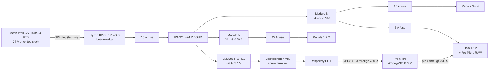

# Wiring: power, Pi and halo

Bought modules wired by hand, no custom PCB. Display: 2 × 2 Waveshare P3 64 × 64 panels
(128 × 128) on a Raspberry Pi 3B with the Electrodragon MPC1119 (V2) HUB75 adapter,
`--led-chain=2 --led-parallel=2`. The HUB75 ribbons are not shown here.

**Status (2026-11-23):** built on the bench; both panel groups and the halo run. Not yet fitted
in the enclosure, soak-tested or hot-plug-tested (checklist in
[#172](https://github.com/sshcrack/led-matrix/issues/172)). Mounting parts: the v0.7 power and
controller plates in [`../oak-panel/`](../oak-panel/README.md).

Printable schematic with pin-by-pin tables: [`schematic.html`](schematic.html) (open it in a browser).



```
brick ─ DIN ─ jack ─ 7.5 A ─┬─ Module A ─ 15 A ─ panels 1+2
                            ├─ Module B ─┬─ 15 A ─ panels 3+4
                            │            └─ 5 A ─ halo strip + Pro Micro RAW
                            └─ LM2596 (5.1 V) ─ Electrodragon VIN ─ Pi
Pi GPIO14 ─ 730 Ω ─ Pro Micro RXI … Pro Micro pin 6 ─ 330 Ω ─ strip DIN
```

The mains part stays outside in the brick; only 24 V enters the box, and each 5 V converter
feeds one panel pair.

## Loads

| Load | Worst case (all white, full brightness) | Supplied by |
|---|---|---|
| Panels 1 + 2 | 40 W, 8 A | Module A (20 A) |
| Panels 3 + 4 | 40 W, 8 A | Module B (20 A) |
| Halo, WS2812B 5 V strip (30 LEDs/m), ≈40 LEDs | 12 W, 2.4 A full white; firmware caps it at 2.5 A | Module B |
| Pi 3B + Electrodragon, no USB devices | ≈3–6 W, 0.5–1.2 A | LM2596 |
| **24 V input** | ≈98 W load, ≈110 W input at ≈90 % → **≈4.6 A** | brick 160 W (6.7 A) |

Each module stays under about 55 % of its rating even on a full-white frame. Ambient scenes draw
far less.

## Protection

| Fault | Covered by |
|---|---|
| Short or overload in a branch | per-branch blade fuse (protects the wire), plus the modules' listed OCP/SCP (unverified) |
| Short on the 24 V side | 7.5 A input fuse and the brick's own current limit |
| Reverse polarity | keyed, latching DIN plug; meter-check the socket wiring once |
| Hot-plugging the brick | fine: the capacitor-charging spike is short and the input fuse has margin |
| Overheating | modules' listed OTP (unverified); check in the soak test |

## Connections

Wire: 1.5 mm² stranded (450/750 V) for everything that carries power, 0.14–0.25 mm² for signals.
Join wires with WAGO 221 lever connectors (strip 11 mm).

### 24 V input

| From | To | Note |
|---|---|---|
| Two meter-verified +24 V cups | +24 V (join both) | Mean Well R7B plug drawing: 1 and 4 |
| Two meter-verified return cups | GND (join both) | Mean Well R7B plug drawing: 2 and 3. Return is tied to mains earth in the brick (Class I). |
| +24 V | 7.5 A blade fuse | inline holder, close to the jack |
| fuse | WAGO **+24 V** (5-way) | outputs: module A IN+, module B IN+, LM2596 IN+ |
| GND | WAGO **GND** (5-way) | outputs: module A IN−, module B IN−, LM2596 IN− |

The [Mean Well R7B plug drawing](https://www.meanwell.com/Upload/PDF/GST160A/GST160A-SPEC.PDF#page=3)
and the [Kycon socket drawing](https://www.kycon.com/Pub_Eng_Draw/KPJX-PM-4S-S.pdf) number the
pins differently. **Meter-check all four cups on the actual mated socket before joining any
wires**: each positive cup reads about +24 V against each return cup. Unplug the brick before
soldering or changing connections.

Socket: solder one 0.75 mm² wire per cup (≈3.4 A each at the brick's full 6.7 A) with heat-shrink
over every cup, before mounting it in the pine strip. Join the two positive and the two return
leads in WAGOs away from the socket. Leave the two shield tabs free.

### Panels

| From | To |
|---|---|
| Module A OUT+ | 15 A fuse → VCC (red) of the panel 1+2 cable |
| Module A OUT− | GND (black) of the panel 1+2 cable |
| Module B OUT+ | WAGO (3-way): 15 A fuse → VCC of the panel 3+4 cable; 5 A fuse → halo +5 V |
| Module B OUT− | WAGO (5-way): GND of the panel 3+4 cable, halo GND, Pro Micro GND |

The module leads (13 cm, bare) and the panel cables join in WAGOs or through the inline fuse
holders. With a barrier strip instead, crimp blue forks (1.5–2.5 mm²) and pull-test each one.

### Pi and Electrodragon

| From | To | Note |
|---|---|---|
| LM2596 OUT+ | Electrodragon **VIN** screw terminal | max 5.5 V. Set **5.1 V** before connecting |
| LM2596 OUT− | Electrodragon **GND** screw terminal | |

- The LM2596's input electrolytic must be rated **≥ 35 V** (printed on the can).
- Set 5.1 V with no load, connect, then re-measure with the Pi running. Fix the trim pot with a
  dab of nail polish. VIN feeds the Pi's 5 V rail past its micro-USB input protection, so a
  drift above 5.5 V kills the Pi.
- Don't power the Pi from USB at the same time.

### Halo

Controller: **Pro Micro (ATmega32U4, 5 V, 16 MHz)**, firmware in `firmware/halo-pro-micro/`. The
Pi's 3.3 V UART TX goes straight into the Pro Micro's RXI through a series resistor; the Pro
Micro drives the strip from its 5 V pin 6.

| From | To | Note |
|---|---|---|
| Electrodragon **IO14** (Pi GPIO14, header pin 8) | 730 Ω → Pro Micro **RXI** (pin 0, `Serial1`) | 3.3 V UART TX; leave the Pro Micro TX pin unconnected |
| Electrodragon **GND** | Pro Micro **GND** | common signal reference |
| Halo +5 V (after the 5 A fuse) | Pro Micro **RAW** and strip +5 V | unplug the RAW wire before connecting USB to flash |
| Pro Micro **pin 6** | 330 Ω → strip **DIN** | 5 V data |
| — | 1000 µF / ≥ 10 V electrolytic across strip +5 V/GND at the strip input | absorbs the switch-on surge |

The WS2812 libraries turn interrupts off while sending (≈1.2 ms for 40 LEDs), so UART bytes
arriving then are lost. The firmware only updates the LEDs after a complete, checksummed frame,
and the Pi sends short frames at 15 Hz, so sending and receiving don't overlap.

Strip: eight 5-LED segments on the rear frame edges facing the wall, in the halo channels,
daisy-chained into one data loop, power fed at the start.

## Grounds

The 24→5 V modules are expected to be non-isolated (IN− = OUT−; check continuity with a meter).
Either way all grounds end up joined, because the HUB75 ribbons tie panel GND to the
Electrodragon and Pi GND. That is intended.

## Layout in the enclosure

- **Power plate** (bottom left, rear view): modules A and B strapped with cable ties, 20 mm free
  at each lead exit for the bend. The removable WAGO deck holds, left to right: A return, fused
  +24 V, 24 V return, B return, B +5 V. Extend the output of the 7.5 A fuse with about 100 mm of
  1.5 mm² wire and an insulated butt crimp, route it through the deck's right-edge tie anchor and
  trim it at the WAGO after checking the slack for opening the cover. Tie the 3-way connector
  that joins the socket leads down near the socket.
- **Fuse holders**: on their sides against the inside of the HDF. The 7.5 A holder 40 mm from the
  bottom pine (keep 25 mm free for the socket pigtail); the two 15 A and the 5 A holder across
  the opening between the electronics and the upper carriers. Dry-fit them before drilling the
  tie holes, and check that the caps open with the holders tied down.
- **Controller plate** (bottom right): Pi + Electrodragon on standoffs, LM2596 and Pro Micro on
  tie anchors.
- Anchor every cable within about 5 cm of each connection. Keep the modules in free air, not in
  foam.

## Pi setup (halo)

- `/boot/firmware/config.txt`: `enable_uart=1` (TX on GPIO14). Remove `console=serial0,115200`
  from `cmdline.txt`.
- GPIO15 (UART RX) is the panels' E address line. The daemon turns the mini UART's receiver off
  and only holds the UART while the halo is on. Check that all 64 rows still show.
- Settings: Integrations page in the web UI, or `GET/POST /halo`. Details: `docs/HALO.md`.

## First power-up

1. Brick → jack only: meter +24 V at the WAGO, correct polarity.
2. Add modules A and B without loads: ≈5 V at each output.
3. Add the LM2596, set 5.1 V, then connect the Electrodragon and Pi.
4. Connect the panels one pair at a time; run a dim scene, then a bright one.
5. Add the halo and Pro Micro last.
6. Soak: a bright scene for 10 minutes, then feel (or measure) the modules and fuse holders.

## Troubleshooting

- **One panel group shows garbage or dim red**: its fuse is out or missing. The Pi keeps driving
  the HUB75 data lines, and the unpowered panels then feed themselves through them, which
  stresses the adapter's buffers. Switch off and check the fuse before running it longer.
- **Rows missing or repeated after enabling the halo**: the E address line (GPIO15) is
  disturbed; check the UART setup above.

## Parts

Bought for this build: Mean Well GST160A24-R7B, Kycon KPJX-PM-4S-S, 2 × Weishuo Y2-T2405
(24→5 V 20 A), 4 × TRU Components 1587493 inline blade fuse holders, blade fuses 15 / 7.5 / 5 A,
1000 µF 35 V capacitors, WAGO 221-413 (3-way) and 221-415 (5-way).

Already owned: Raspberry Pi 3B, four panels, Electrodragon MPC1119, HUB75 ribbons (150 mm), panel
power cables, 1.5 mm² wire, LM2596 HW-411, Pro Micro 5 V, WS2812B strip (30/m, 5 m), resistors,
heat-shrink, cable ties, IEC C13 mains cord.

Screws, washers and wood: see [`../oak-panel/`](../oak-panel/README.md) and #170.
